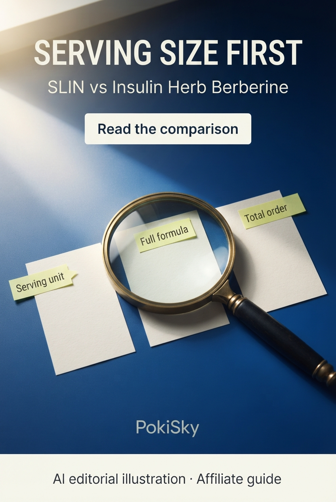

# PokiSky — cinco novos posts para Pinterest e Facebook

Campanha de 28/10/2026. Cinco artes individuais geradas na interface web do Gemini, revisadas visualmente e salvas em JPG de 848 × 1264 pixels. Textos em inglês, divulgação de afiliados e identificação de arte editorial feita com IA. Base: comparações do blog revisadas em 27/10/2026; preços e rótulos de fornecedores não foram revalidados nesta campanha.

**Status:** published_pinterest_and_facebook

## Publicação e identidade

Pinterest: pasta Supplement Buying Guides | PokiSky. Facebook: página PokiSky Supplement Guides. Cinco temas com novos títulos, enfoques e composições; as comparações gerais desses produtos já tinham posts anteriores. A pasta do Pinterest passou de 31 para 36 Pins após esta rodada. Nenhum anúncio pago, botão de telefone ou agendamento foi configurado.

Os parâmetros UTM distinguem a rede e a peça, mas não medem visitas por conta própria. Os textos alternativos foram conferidos com as imagens finais; o manifesto registra dimensões e hashes dos arquivos.

## 1. SLIN vs Insulin Herb Berberine: compare the serving first

**Mercado e limite:** United States; verify the exact offer and address

### Pinterest

**Título:** SLIN vs Insulin Herb Berberine: compare the serving first

Ad / affiliate disclosure: the linked guide contains affiliate links. Comparing SLIN and Insulin Herb Berberine? Start with the serving unit, then the full formula and total order. A matching ingredient name does not make two products equivalent. Save this checklist and read the side-by-side guide. AI editorial illustration; not product photography.

**Destino do guia:** https://blog-travel-eight.vercel.app/topics/wellness/metabolic-health/slin-vs-insulin-herb-berberine?utm_source=pinterest&utm_medium=organic_social&utm_campaign=comparison_guides_20261028&utm_content=serving_size_first

**Pin publicado:** https://br.pinterest.com/pin/765471267964072338/

### Facebook

Ad / affiliate disclosure: the linked guide contains affiliate links.

A matching ingredient name is only the start of a comparison.

Before comparing SLIN and Insulin Herb Berberine, put three things side by side:
• The serving unit behind each label amount.
• The complete ingredient list for the exact version.
• The quantity and delivered total of the linked order.

Our guide keeps label differences and unresolved questions visible. It does not rank health results or recommend a dose.

Read the comparison:
https://blog-travel-eight.vercel.app/topics/wellness/metabolic-health/slin-vs-insulin-herb-berberine?utm_source=facebook&utm_medium=organic_social&utm_campaign=comparison_guides_20261028&utm_content=serving_size_first

AI editorial illustration; not product photography.

**Publicação:** https://www.facebook.com/photo/?fbid=122097164649532355&set=a.122094306885532355

### Texto alternativo

Editorial graphic with a magnifying glass and two abstract label cards. Text: Serving size first. SLIN vs Insulin Herb Berberine. Compare the serving unit, full formula and total order. PokiSky. AI editorial illustration and affiliate guide.

## 2. Gluconite vs Elixolve Sleep Strips: look beyond the format

**Mercado e limite:** United States; confirm current labels and shipping

### Pinterest

**Título:** Gluconite vs Elixolve Sleep Strips: look beyond the format

Ad / affiliate disclosure: the linked guide contains affiliate links. Gluconite and Elixolve Sleep Strips use different formats. Compare the full label, declared serving and package quantity before the purchase terms. Similar marketing does not establish equivalent formulas or results. Save the checklist and open the comparison. AI editorial illustration; not product photography.

**Destino do guia:** https://blog-travel-eight.vercel.app/topics/wellness/nutrition/gluconite-vs-elixolve-sleep-strips?utm_source=pinterest&utm_medium=organic_social&utm_campaign=comparison_guides_20261028&utm_content=nighttime_label_check

**Pin publicado:** https://br.pinterest.com/pin/765471267964072342/

### Facebook

Ad / affiliate disclosure: the linked guide contains affiliate links.

Different formats. A comparison still starts with the label.

Our Gluconite vs Elixolve Sleep Strips guide separates what the reviewed supplier information states from what still needs confirmation.

Before ordering, check:
• The complete current panel.
• The serving definition and total package quantity.
• Shipping, return deadlines and return postage.

The guide compares label information and purchase conditions; it does not claim one product improves sleep more.

Read the comparison:
https://blog-travel-eight.vercel.app/topics/wellness/nutrition/gluconite-vs-elixolve-sleep-strips?utm_source=facebook&utm_medium=organic_social&utm_campaign=comparison_guides_20261028&utm_content=nighttime_label_check

AI editorial illustration; not product photography.

**Publicação:** https://www.facebook.com/photo/?fbid=122097173301532355&set=a.122094306885532355

### Texto alternativo

Midnight-purple editorial scene with an open notebook, a crescent-shaped paper sculpture and three checklist tabs. Text: Look beyond the format. Gluconite vs Elixolve Sleep Strips. Full label, serving definition, pack quantity. PokiSky. AI editorial illustration and affiliate guide.

## 3. BrainAMP vs Advanced Memory Formula: compare ingredient forms

**Mercado e limite:** UK reader context; confirm each product's delivery separately

### Pinterest

**Título:** BrainAMP vs Advanced Memory Formula: compare ingredient forms

Ad / affiliate disclosure: the linked guide contains affiliate links. BrainAMP vs Advanced Memory Formula: compare ingredient form, label serving and allergen information—not just ingredient counts. Delivery needs a separate check for each offer. Save this reading checklist and explore the guide. No ranking of memory or focus results. AI editorial illustration; not product photography.

**Destino do guia:** https://blog-travel-eight.vercel.app/topics/wellness/brain-health/brainamp-vs-advanced-memory-formula?utm_source=pinterest&utm_medium=organic_social&utm_campaign=comparison_guides_20261028&utm_content=ingredient_form_check

**Pin publicado:** https://br.pinterest.com/pin/765471267964072359/

### Facebook

Ad / affiliate disclosure: the linked guide contains affiliate links.

A longer ingredient list does not settle a buying decision.

The BrainAMP vs Advanced Memory Formula comparison looks at ingredient forms, serving definitions and the allergen information recorded in the supplier panels. It also keeps delivery questions separate for each offer.

Three questions to keep beside the labels:
• Is the ingredient form the same?
• What serving does the amount describe?
• What warnings and allergens need attention?

This is a label-reading guide, not a promise of better memory or focus. Read the comparison:
https://blog-travel-eight.vercel.app/topics/wellness/brain-health/brainamp-vs-advanced-memory-formula?utm_source=facebook&utm_medium=organic_social&utm_campaign=comparison_guides_20261028&utm_content=ingredient_form_check

AI editorial illustration; not product photography.

**Publicação:** https://www.facebook.com/photo/?fbid=122097180243532355&set=a.122094306885532355

### Texto alternativo

Cream and burnt-orange typographic poster with transparent overlapping geometric shapes and three editorial callouts. Text: Read the form, not just the name. BrainAMP vs Advanced Memory Formula. Ingredient form, label serving, allergen information. PokiSky. AI editorial illustration and affiliate guide.

## 4. Advanced Muscle Plus vs Advanced Amino Formula: label before price

**Mercado e limite:** United Kingdom and Ireland; confirm the exact order address

### Pinterest

**Título:** Advanced Muscle Plus vs Advanced Amino Formula: label before price

Ad / affiliate disclosure: the linked guide contains affiliate links. Advanced Muscle Plus and Advanced Amino Formula have different label profiles. Compare the full formula, serving definition and warnings before pack prices. Then check quantity, delivery and return conditions. Save the checklist and read the comparison. AI editorial illustration; not product photography.

**Destino do guia:** https://blog-travel-eight.vercel.app/topics/wellness/nutrition/advanced-muscle-plus-vs-advanced-amino-formula?utm_source=pinterest&utm_medium=organic_social&utm_campaign=comparison_guides_20261028&utm_content=full_formula_before_price

**Pin publicado:** https://br.pinterest.com/pin/765471267964072371/

### Facebook

Ad / affiliate disclosure: the linked guide contains affiliate links.

Before the pack price, read the full formula.

Advanced Muscle Plus and Advanced Amino Formula are different formulations. Our comparison keeps their label information, serving definitions and unresolved details side by side.

Start with the ingredients and warnings. Then compare matching package quantities and an address-specific delivered total. Take the full labels to a qualified professional if you need help assessing suitability.

The guide does not promise strength, muscle gain or equivalent results.

Read the comparison:
https://blog-travel-eight.vercel.app/topics/wellness/nutrition/advanced-muscle-plus-vs-advanced-amino-formula?utm_source=facebook&utm_medium=organic_social&utm_campaign=comparison_guides_20261028&utm_content=full_formula_before_price

AI editorial illustration; not product photography.

**Publicação:** https://www.facebook.com/photo/?fbid=122097184185532355&set=a.122094306885532355

### Texto alternativo

Forest-green editorial still life of folded cream paper, a graphite pencil and layered comparison sheets. Text: Label before price. Advanced Muscle Plus vs Advanced Amino Formula. Full formula, serving definition, warnings and order terms. PokiSky. AI editorial illustration and affiliate guide.

## 5. SelfPlus AGE+ vs Advanced Mitochondrial Formula: check the buying route

**Mercado e limite:** Separate US and UK/Ireland purchasing routes; no common destination assumed

### Pinterest

**Título:** SelfPlus AGE+ vs Advanced Mitochondrial Formula: check the buying route

Ad / affiliate disclosure: the linked guide contains affiliate links. SelfPlus AGE+ and Advanced Mitochondrial Formula differ in label scope and buying route. Start with destination eligibility, then compare the full formula and delivered total. Do not assume both offers serve the same country. Save this checklist and read the comparison. AI editorial illustration; not product photography.

**Destino do guia:** https://blog-travel-eight.vercel.app/topics/wellness/longevity/selfplus-age-plus-vs-advanced-mitochondrial-formula?utm_source=pinterest&utm_medium=organic_social&utm_campaign=comparison_guides_20261028&utm_content=check_destination_first

**Pin publicado:** https://br.pinterest.com/pin/765471267964072407/

### Facebook

Ad / affiliate disclosure: the linked guide contains affiliate links.

Can the exact offer serve your address? Start there.

Our SelfPlus AGE+ vs Advanced Mitochondrial Formula guide compares different label scopes and separate purchasing routes. The registered information describes a US route for AGE+ and a UK/Ireland offer for Mitochondrial Formula; it does not establish a shared delivery destination.

Before comparing price:
• Confirm country and address eligibility.
• Read each complete formula and label serving.
• Request the final delivered total and return terms.

This is a buying comparison, not a longevity promise. Read the guide:
https://blog-travel-eight.vercel.app/topics/wellness/longevity/selfplus-age-plus-vs-advanced-mitochondrial-formula?utm_source=facebook&utm_medium=organic_social&utm_campaign=comparison_guides_20261028&utm_content=check_destination_first

AI editorial illustration; not product photography.

**Publicação:** https://www.facebook.com/photo/?fbid=122097186801532355&set=a.122094306885532355

### Texto alternativo

Pale-blue editorial graphic with two separate cobalt paths, coral dots and sculpted paper shapes. Text: Check the buying route. SelfPlus AGE+ and Advanced Mitochondrial Formula. Destination eligibility, complete formula and delivered total. Explore the comparison. PokiSky. AI editorial illustration and affiliate guide.
