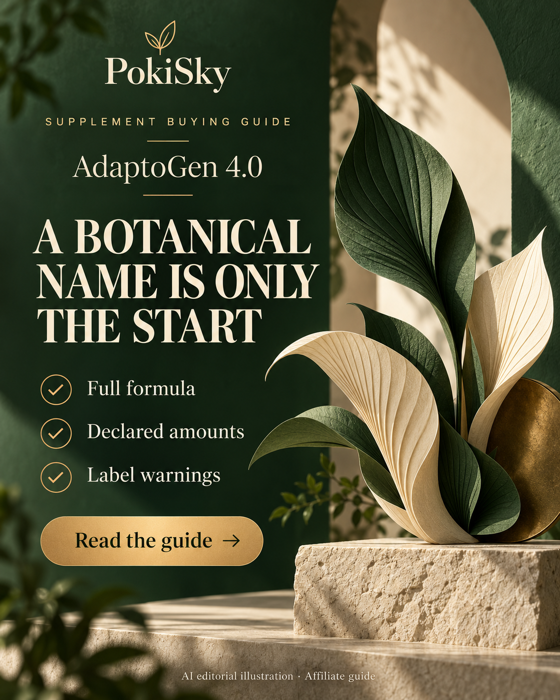
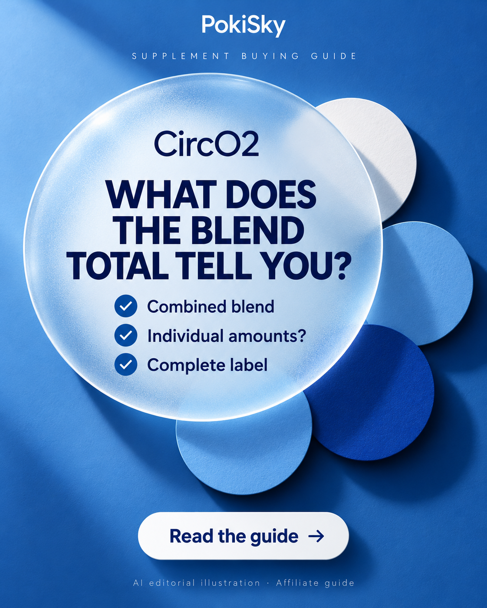
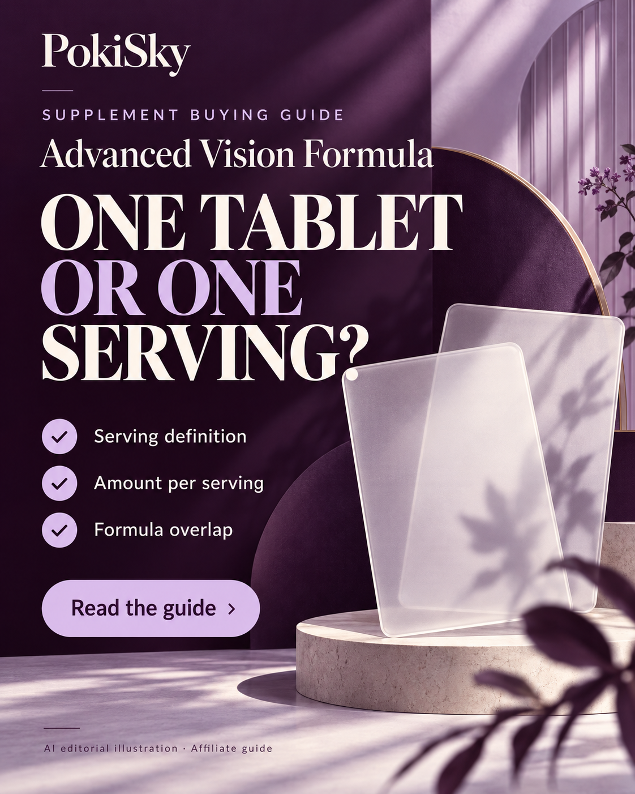
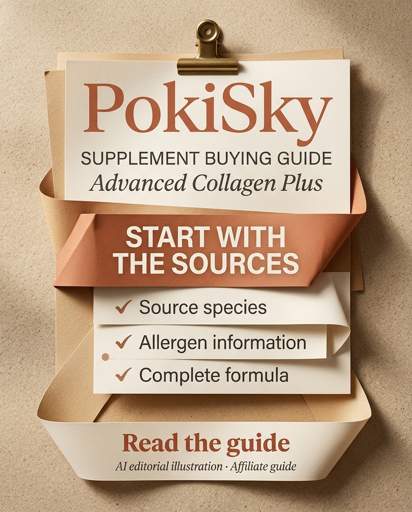
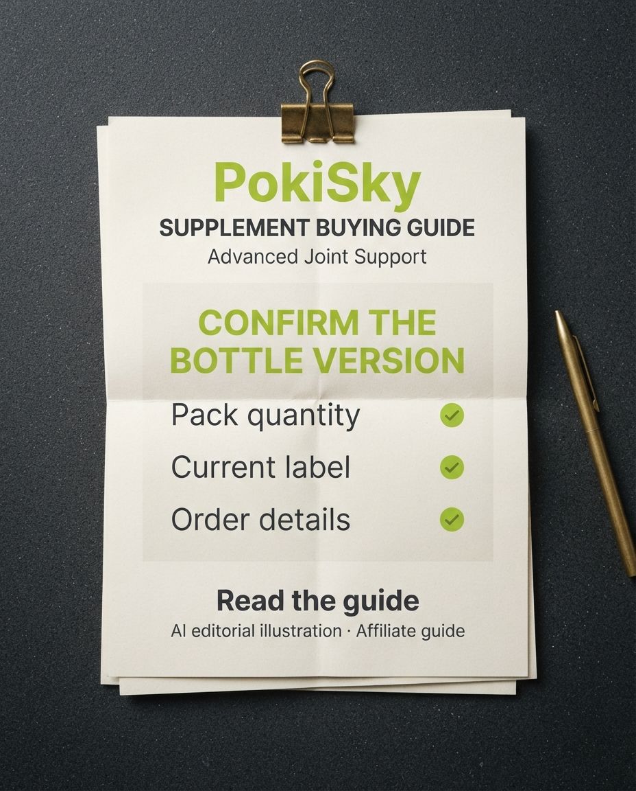

# PokiSky — 5 posts de suplementos — 30/10/2026

Status: textos preparados para as três redes; nenhuma publicação realizada nesta campanha. Inglês conforme os perfis existentes. Cinco artes revisadas; as duas últimas foram geradas e baixadas no Gemini, conforme solicitado. As três primeiras vieram da geração integrada iniciada anteriormente.

Os posts adaptam guias existentes; não representam nova verificação de rótulos, preços ou condições comerciais. As datas das fontes estão no JSON. Os links de Instagram na legenda são texto simples; não pressupor link clicável na bio.

## AdaptoGen 4.0

Arte: reviewed. Fonte: [guia do blog](https://blog-travel-eight.vercel.app/topics/wellness/nutrition/adaptogen-4).

### Pinterest

**Título:** AdaptoGen 4.0: read beyond the botanical name

Ad / affiliate disclosure: the linked PokiSky guide contains affiliate links. Comparing AdaptoGen 4.0? Read the complete formula, declared amounts and label warnings before comparing bottle bundles. Our guide separates supplier information from buying questions. Save this checklist and read the guide. AI editorial illustration; not product photography.

**Link de destino:** https://blog-travel-eight.vercel.app/topics/wellness/nutrition/adaptogen-4?utm_source=pinterest&utm_medium=organic_social&utm_campaign=supplement_checks_20261030&utm_content=adaptogen-4

### Facebook

Ad / affiliate disclosure: the linked PokiSky guide contains affiliate links.

A familiar botanical name is only the start.

The PokiSky AdaptoGen 4.0 guide walks through the supplier's declared formula and the questions behind a purchase:
• Which ingredients and amounts are listed?
• What warnings and possible allergens need attention?
• Which conditions apply to the advertised refund?

Read the complete current label and policy before choosing a pack. The guide does not establish results for the finished formula.

Read the guide:
https://blog-travel-eight.vercel.app/topics/wellness/nutrition/adaptogen-4?utm_source=facebook&utm_medium=organic_social&utm_campaign=supplement_checks_20261030&utm_content=adaptogen-4

AI editorial illustration; not product photography.

### Instagram

Ad / affiliate disclosure: the linked PokiSky guide contains affiliate links.

What sits behind a botanical name? 🌿

For AdaptoGen 4.0, start with the full formula, declared amounts and label warnings. Then read the detailed refund conditions before comparing bundles.

Save this checklist. Find “AdaptoGen 4.0” on the PokiSky blog for the full buying guide.

Guide address (plain-text URL):
https://blog-travel-eight.vercel.app/topics/wellness/nutrition/adaptogen-4?utm_source=instagram&utm_medium=organic_social&utm_campaign=supplement_checks_20261030&utm_content=adaptogen-4

AI editorial illustration; not product photography.

#SupplementLabels #BuyingGuide #PokiSky

**Texto alternativo:** AdaptoGen 4.0 editorial poster. Headline: A BOTANICAL NAME IS ONLY THE START. Checklist: Full formula; Declared amounts; Label warnings. PokiSky. Read the guide. AI editorial illustration; affiliate guide.

## CircO2

Arte: reviewed. Fonte: [guia do blog](https://blog-travel-eight.vercel.app/topics/wellness/longevity/circo2).

### Pinterest

**Título:** CircO2: a blend total is not an ingredient breakdown

Ad / affiliate disclosure: the linked PokiSky guide contains affiliate links. What does the CircO2 blend total tell you? Our guide explains the combined blend and which individual amounts remain undisclosed in the reviewed label. Check the complete label, warnings and exact delivery address before ordering. Save for your next label comparison. AI editorial illustration; not product photography.

**Link de destino:** https://blog-travel-eight.vercel.app/topics/wellness/longevity/circo2?utm_source=pinterest&utm_medium=organic_social&utm_campaign=supplement_checks_20261030&utm_content=circo2

### Facebook

Ad / affiliate disclosure: the linked PokiSky guide contains affiliate links.

One combined blend total leaves a useful follow-up question: how much of each ingredient is disclosed?

The CircO2 guide distinguishes the nutrients listed separately from ingredients grouped in a proprietary blend. Check:
• The complete formula and other ingredients.
• Which amounts are individual and which are combined.
• The current delivery and return terms for your address.

The blend name alone does not establish a circulation benefit.

Read the guide:
https://blog-travel-eight.vercel.app/topics/wellness/longevity/circo2?utm_source=facebook&utm_medium=organic_social&utm_campaign=supplement_checks_20261030&utm_content=circo2

AI editorial illustration; not product photography.

### Instagram

Ad / affiliate disclosure: the linked PokiSky guide contains affiliate links.

A blend total is one piece of the label. 🔎

The CircO2 guide separates individually listed nutrients from the combined blend. Ask what the label discloses about each ingredient before comparing packs.

Save this question for your next label check. Find “CircO2” on the PokiSky blog.

Guide address (plain-text URL):
https://blog-travel-eight.vercel.app/topics/wellness/longevity/circo2?utm_source=instagram&utm_medium=organic_social&utm_campaign=supplement_checks_20261030&utm_content=circo2

AI editorial illustration; not product photography.

#LabelReading #SupplementGuide #PokiSky

**Texto alternativo:** CircO2 editorial poster. Headline: WHAT DOES THE BLEND TOTAL TELL YOU?. Checklist: Combined blend; Individual amounts?; Complete label. PokiSky. Read the guide. AI editorial illustration; affiliate guide.

## Advanced Vision Formula

Arte: reviewed. Fonte: [guia do blog](https://blog-travel-eight.vercel.app/topics/wellness/vision-health/advanced-vision-formula).

### Pinterest

**Título:** Advanced Vision Formula: check the serving unit first

Ad / affiliate disclosure: the linked PokiSky guide contains affiliate links. Comparing Advanced Vision Formula label amounts? Check the serving definition before reading individual numbers, then review the whole formula and possible overlap with other supplements. Save this label-reading checklist and explore the PokiSky buying guide. AI editorial illustration; not product photography.

**Link de destino:** https://blog-travel-eight.vercel.app/topics/wellness/vision-health/advanced-vision-formula?utm_source=pinterest&utm_medium=organic_social&utm_campaign=supplement_checks_20261030&utm_content=advanced-vision-formula

### Facebook

Ad / affiliate disclosure: the linked PokiSky guide contains affiliate links.

Before comparing a label amount, check what one serving means.

Our Advanced Vision Formula guide explains the supplier's serving definition and complete formula. Keep these questions beside the label:
• Is an amount per tablet or per label serving?
• Which other ingredients and excipients are included?
• What overlap with other supplements needs discussion with a qualified professional?

The product does not replace prescribed eye care. Read the current label and order details before deciding.

Read the guide:
https://blog-travel-eight.vercel.app/topics/wellness/vision-health/advanced-vision-formula?utm_source=facebook&utm_medium=organic_social&utm_campaign=supplement_checks_20261030&utm_content=advanced-vision-formula

AI editorial illustration; not product photography.

### Instagram

Ad / affiliate disclosure: the linked PokiSky guide contains affiliate links.

One tablet and one label serving may describe different quantities. 📋

Start with the serving definition when reading Advanced Vision Formula, then check the full formula and ingredient overlap.

Save this reminder. Find “Advanced Vision Formula” on the PokiSky blog. Continue prescribed eye care.

Guide address (plain-text URL):
https://blog-travel-eight.vercel.app/topics/wellness/vision-health/advanced-vision-formula?utm_source=instagram&utm_medium=organic_social&utm_campaign=supplement_checks_20261030&utm_content=advanced-vision-formula

AI editorial illustration; not product photography.

#SupplementLabels #LabelChecklist #PokiSky

**Texto alternativo:** Advanced Vision Formula editorial poster. Headline: ONE TABLET OR ONE SERVING?. Checklist: Serving definition; Amount per serving; Formula overlap. PokiSky. Read the guide. AI editorial illustration; affiliate guide.

## Advanced Collagen Plus

Arte: reviewed — Gemini web. Fonte: [guia do blog](https://blog-travel-eight.vercel.app/topics/wellness/longevity/collagen).

### Pinterest

**Título:** Advanced Collagen Plus: check sources and allergy information

Ad / affiliate disclosure: the linked PokiSky guide contains affiliate links. Advanced Collagen Plus: start with source species and allergen information rather than the number of collagen types. The PokiSky guide summarises the supplier's source information and buying questions. Read the complete current label before choosing a powder. Save this checklist. AI editorial illustration; not product photography.

**Link de destino:** https://blog-travel-eight.vercel.app/topics/wellness/longevity/collagen?utm_source=pinterest&utm_medium=organic_social&utm_campaign=supplement_checks_20261030&utm_content=collagen

### Facebook

Ad / affiliate disclosure: the linked PokiSky guide contains affiliate links.

For a collagen powder, source information belongs near the top of the checklist.

The seller describes Advanced Collagen Plus as a multi-source formula. Our guide helps you check:
• The source species listed for the product.
• The complete allergen and ingredient statements.
• The serving information and current purchase terms.

A mixing demonstration cannot establish purity or effectiveness. Read the guide, and confirm any dietary restrictions or allergy questions before ordering.

Read the guide:
https://blog-travel-eight.vercel.app/topics/wellness/longevity/collagen?utm_source=facebook&utm_medium=organic_social&utm_campaign=supplement_checks_20261030&utm_content=collagen

AI editorial illustration; not product photography.

### Instagram

Ad / affiliate disclosure: the linked PokiSky guide contains affiliate links.

Start with the sources. 📖

Before choosing Advanced Collagen Plus, read the source species, allergen information and complete formula. The number of collagen types does not answer those questions for you.

Save this checklist. Find “Advanced Collagen Plus” on the PokiSky blog.

Guide address (plain-text URL):
https://blog-travel-eight.vercel.app/topics/wellness/longevity/collagen?utm_source=instagram&utm_medium=organic_social&utm_campaign=supplement_checks_20261030&utm_content=collagen

AI editorial illustration; not product photography.

#CollagenGuide #IngredientLabels #PokiSky

**Texto alternativo:** Advanced Collagen Plus editorial poster. Headline: START WITH THE SOURCES. Checklist: Source species; Allergen information; Complete formula. PokiSky. Read the guide. AI editorial illustration; affiliate guide.

## Advanced Joint Support

Arte: reviewed — Gemini web. Fonte: [guia do blog](https://blog-travel-eight.vercel.app/topics/wellness/joint-health/advanced-joint-support).

### Pinterest

**Título:** Advanced Joint Support: confirm the bottle version before comparing

Ad / affiliate disclosure: the linked PokiSky guide contains affiliate links. Which bottle version are you comparing? The Advanced Joint Support guide records a tablet-count discrepancy in supplier images and the full label. Confirm the version being shipped, current directions and order quantity before comparing supply length. Save this buying checklist. AI editorial illustration; not product photography.

**Link de destino:** https://blog-travel-eight.vercel.app/topics/wellness/joint-health/advanced-joint-support?utm_source=pinterest&utm_medium=organic_social&utm_campaign=supplement_checks_20261030&utm_content=advanced-joint-support

### Facebook

Ad / affiliate disclosure: the linked PokiSky guide contains affiliate links.

Check that the bottle photograph and full label describe the same version.

The Advanced Joint Support guide records a tablet-count discrepancy in the supplier materials reviewed. Before estimating value or supply length:
• Ask which version will actually ship.
• Request the matching current label and directions.
• Confirm the selected pack and final delivery total.

The discrepancy remains unresolved in the guide. Ingredient names do not establish pain relief.

Read the guide:
https://blog-travel-eight.vercel.app/topics/wellness/joint-health/advanced-joint-support?utm_source=facebook&utm_medium=organic_social&utm_campaign=supplement_checks_20261030&utm_content=advanced-joint-support

AI editorial illustration; not product photography.

### Instagram

Ad / affiliate disclosure: the linked PokiSky guide contains affiliate links.

Does the bottle photo match the full label? 🔎

Our Advanced Joint Support guide records a tablet-count discrepancy in the supplier materials reviewed. Confirm the version being shipped before estimating supply length or comparing packs.

Save this buying question. Find “Advanced Joint Support” on the PokiSky blog.

Guide address (plain-text URL):
https://blog-travel-eight.vercel.app/topics/wellness/joint-health/advanced-joint-support?utm_source=instagram&utm_medium=organic_social&utm_campaign=supplement_checks_20261030&utm_content=advanced-joint-support

AI editorial illustration; not product photography.

#BuyingChecklist #SupplementGuide #PokiSky

**Texto alternativo:** Advanced Joint Support editorial poster. Headline: CONFIRM THE BOTTLE VERSION. Checklist: Pack quantity; Current label; Order details. PokiSky. Read the guide. AI editorial illustration; affiliate guide.
