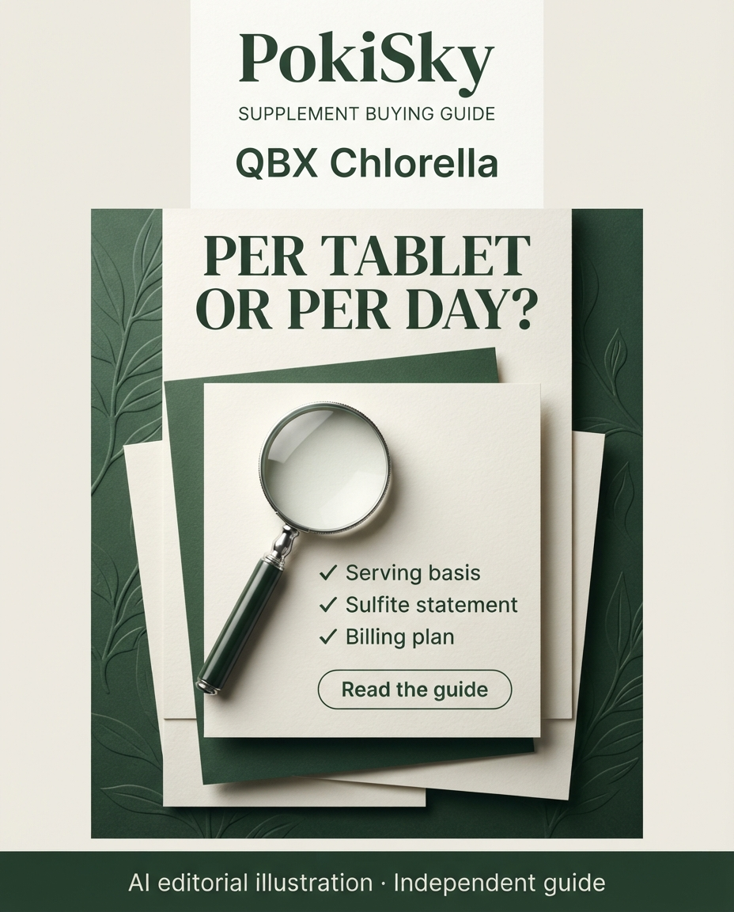
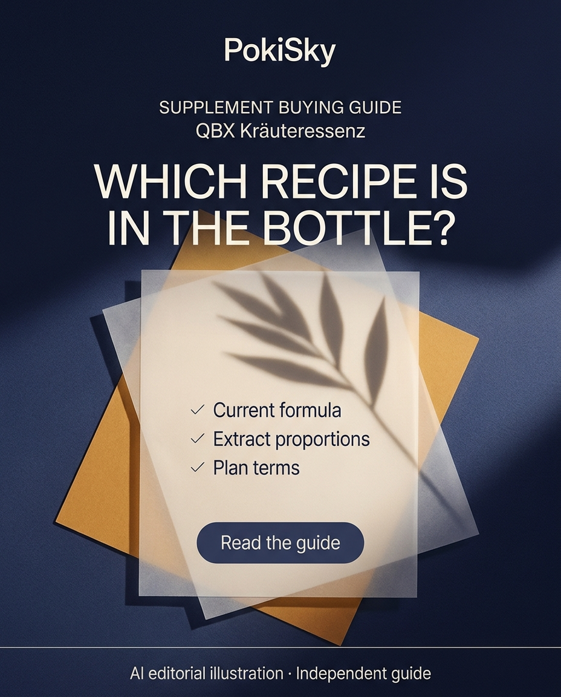
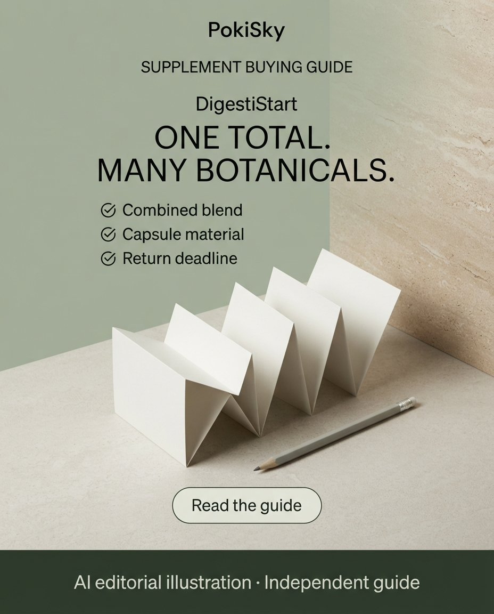
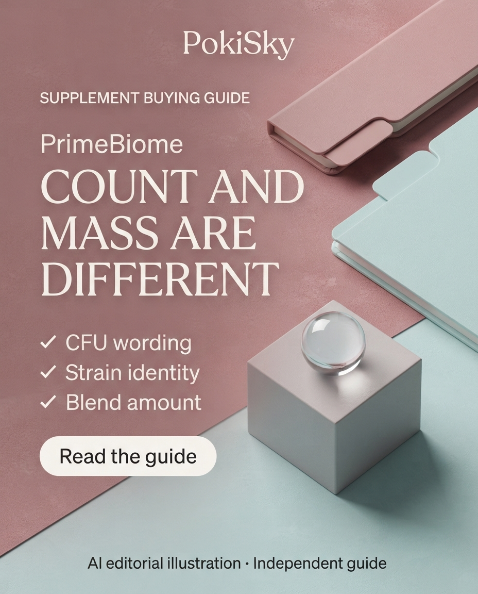
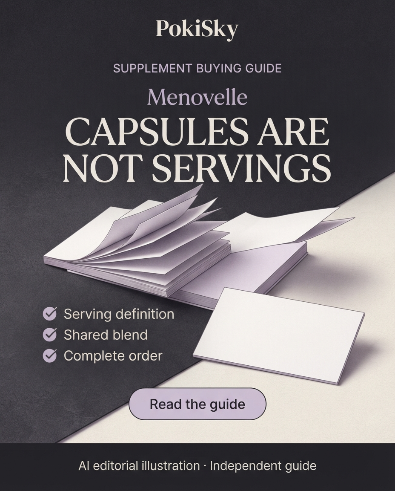
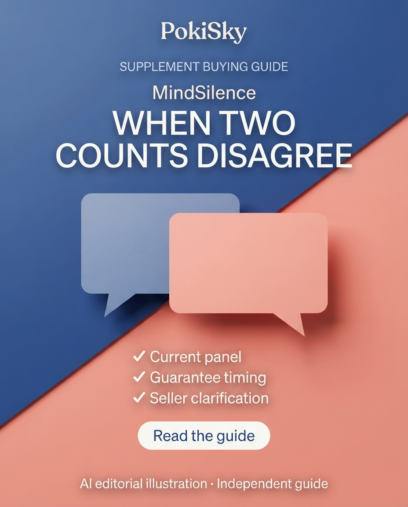
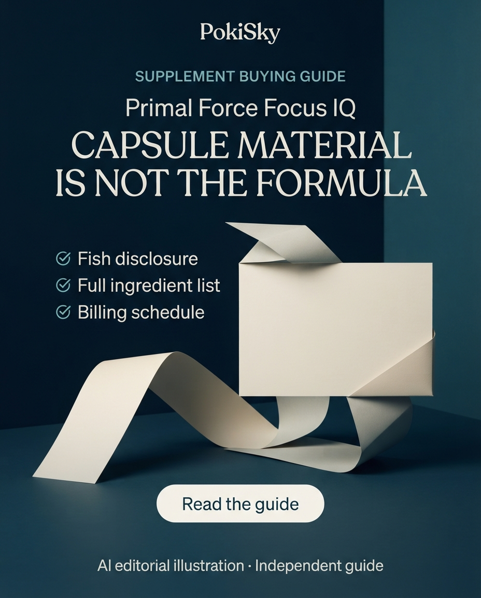
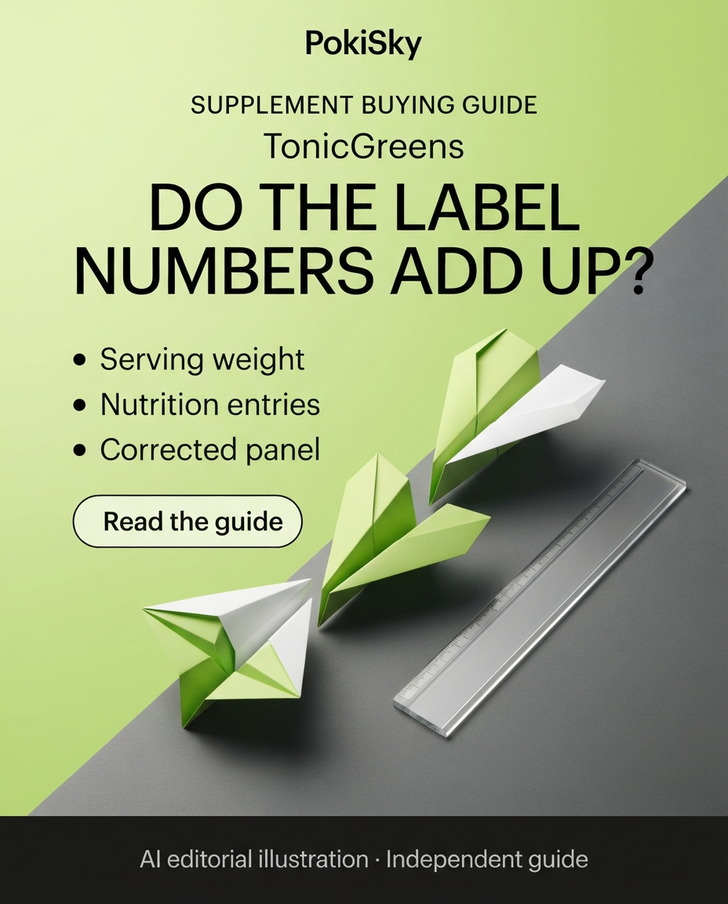

# QBX Chlorella

## Pinterest

QBX Chlorella: per tablet or per day

Editorial disclosure: this guide uses untracked official links. The QBX Chlorella guide separates a tablet amount from the stated daily serving and keeps the sulfite warning visible. Compare the formula and the minimum commitment of recurring delivery. German-language guide; Germany buying context. Save the checklist and read the guide. AI editorial illustration; not product photography.

https://blog-travel-eight.vercel.app/topics/wellness/nutrition/qbx-chlorella?utm_source=pinterest&utm_medium=organic_social&utm_campaign=supplement_labels_20261101&utm_content=qbx-chlorella

Published: https://br.pinterest.com/pin/765471267964134116/

## Facebook

Editorial disclosure: this guide uses untracked official links.

PER TABLET OR PER DAY?

The QBX Chlorella guide separates a tablet amount from the stated daily serving and keeps the sulfite warning visible. Compare the formula and the minimum commitment of recurring delivery. German-language guide; Germany buying context.

Read the source-based guide:
https://blog-travel-eight.vercel.app/topics/wellness/nutrition/qbx-chlorella?utm_source=facebook&utm_medium=organic_social&utm_campaign=supplement_labels_20261101&utm_content=qbx-chlorella

AI editorial illustration; not product photography.

Published: https://facebook.com/permalink.php?story_fbid=pfbid07SNx6Gpuh7WbWcWV8UuEY9ZoXDmv4yWgMZxpmKLT8bDCFGEdWoXZPXSWzZDVVvnZl&id=61595970654481

## Instagram

Editorial disclosure: this guide uses untracked official links.

PER TABLET OR PER DAY?

The QBX Chlorella guide separates a tablet amount from the stated daily serving and keeps the sulfite warning visible. Compare the formula and the minimum commitment of recurring delivery. German-language guide; Germany buying context.

Save this checklist. Find “QBX Chlorella” on the PokiSky blog.

Guide address (copy into your browser):
https://blog-travel-eight.vercel.app/topics/wellness/nutrition/qbx-chlorella?utm_source=instagram&utm_medium=organic_social&utm_campaign=supplement_labels_20261101&utm_content=qbx-chlorella

AI editorial illustration; not product photography.

#SupplementLabels #BuyingGuide #PokiSky

Published: https://instagram.com/pokisky.guides/p/DfM0gFWDvJZ/

## Story / Highlight

Nutrition: published_and_in_highlight

https://instagram.com/stories/highlights/17894119074616970/

## Alt text

PokiSky supplement buying guide for QBX Chlorella. Headline: PER TABLET OR PER DAY?. Checklist: Serving basis; Sulfite statement; Billing plan. Read the guide. AI editorial illustration; independent guide.

---

# QBX Kräuteressenz

## Pinterest

QBX Kräuteressenz: which recipe is in the bottle

Editorial disclosure: this guide uses untracked official links. The current QBX herbal essence is described as an alcohol-free combination. Extract proportions do not establish each ingredient amount in a daily serving. Compare the actual label and selected billing plan. German-language guide; Germany buying context. Save the checklist and read the guide. AI editorial illustration; not product photography.

https://blog-travel-eight.vercel.app/topics/wellness/gut-health/qbx-kraeuteressenz?utm_source=pinterest&utm_medium=organic_social&utm_campaign=supplement_labels_20261101&utm_content=qbx-kraeuteressenz

Published: https://br.pinterest.com/pin/765471267964133984/

## Facebook

Editorial disclosure: this guide uses untracked official links.

WHICH RECIPE IS IN THE BOTTLE?

The current QBX herbal essence is described as an alcohol-free combination. Extract proportions do not establish each ingredient amount in a daily serving. Compare the actual label and selected billing plan. German-language guide; Germany buying context.

Read the source-based guide:
https://blog-travel-eight.vercel.app/topics/wellness/gut-health/qbx-kraeuteressenz?utm_source=facebook&utm_medium=organic_social&utm_campaign=supplement_labels_20261101&utm_content=qbx-kraeuteressenz

AI editorial illustration; not product photography.

Published: https://facebook.com/permalink.php?story_fbid=pfbid0t5kWPXbKLTjonSRfQFgGhZibeyZ1jXMkreoeLZM6c5oBYw6A8JfZrc1BcJdQRhAAl&id=61595970654481

## Instagram

Editorial disclosure: this guide uses untracked official links.

WHICH RECIPE IS IN THE BOTTLE?

The current QBX herbal essence is described as an alcohol-free combination. Extract proportions do not establish each ingredient amount in a daily serving. Compare the actual label and selected billing plan. German-language guide; Germany buying context.

Save this checklist. Find “QBX Kräuteressenz” on the PokiSky blog.

Guide address (copy into your browser):
https://blog-travel-eight.vercel.app/topics/wellness/gut-health/qbx-kraeuteressenz?utm_source=instagram&utm_medium=organic_social&utm_campaign=supplement_labels_20261101&utm_content=qbx-kraeuteressenz

AI editorial illustration; not product photography.

#SupplementLabels #BuyingGuide #PokiSky

Published: https://instagram.com/pokisky.guides/p/DfMzaI1jmR9/

## Story / Highlight

Digestion: published_and_in_highlight

https://instagram.com/stories/highlights/18106038518269274/

## Alt text

PokiSky supplement buying guide for QBX Kräuteressenz. Headline: WHICH RECIPE IS IN THE BOTTLE?. Checklist: Current formula; Extract proportions; Plan terms. Read the guide. AI editorial illustration; independent guide.

---

# DigestiStart

## Pinterest

DigestiStart: one total. many botanicals.

Editorial disclosure: this guide uses untracked official links. DigestiStart lists one combined amount for its botanical blend. The guide also checks gelatin in the capsule and a refund deadline that does not match the longer trial suggestion. A blend total does not establish treatment effectiveness. Save the checklist and read the guide. AI editorial illustration; not product photography.

https://blog-travel-eight.vercel.app/topics/wellness/gut-health/digestistart?utm_source=pinterest&utm_medium=organic_social&utm_campaign=supplement_labels_20261101&utm_content=digestistart

Published: https://br.pinterest.com/pin/765471267964134013/

## Facebook

Editorial disclosure: this guide uses untracked official links.

ONE TOTAL. MANY BOTANICALS.

DigestiStart lists one combined amount for its botanical blend. The guide also checks gelatin in the capsule and a refund deadline that does not match the longer trial suggestion. A blend total does not establish treatment effectiveness.

Read the source-based guide:
https://blog-travel-eight.vercel.app/topics/wellness/gut-health/digestistart?utm_source=facebook&utm_medium=organic_social&utm_campaign=supplement_labels_20261101&utm_content=digestistart

AI editorial illustration; not product photography.

Published: https://facebook.com/permalink.php?story_fbid=pfbid03vGMdVE8a4WJ6VRBTYUTVMWjwhANaAHcuUtz8SbraRse472Sa6H3MinkBUY24gt7l&id=61595970654481

## Instagram

Editorial disclosure: this guide uses untracked official links.

ONE TOTAL. MANY BOTANICALS.

DigestiStart lists one combined amount for its botanical blend. The guide also checks gelatin in the capsule and a refund deadline that does not match the longer trial suggestion. A blend total does not establish treatment effectiveness.

Save this checklist. Find “DigestiStart” on the PokiSky blog.

Guide address (copy into your browser):
https://blog-travel-eight.vercel.app/topics/wellness/gut-health/digestistart?utm_source=instagram&utm_medium=organic_social&utm_campaign=supplement_labels_20261101&utm_content=digestistart

AI editorial illustration; not product photography.

#SupplementLabels #BuyingGuide #PokiSky

Published: https://instagram.com/pokisky.guides/p/DfMzmpvjqPq/

## Story / Highlight

Digestion: published_and_in_highlight

https://instagram.com/stories/highlights/18106038518269274/

## Alt text

PokiSky supplement buying guide for DigestiStart. Headline: ONE TOTAL. MANY BOTANICALS.. Checklist: Combined blend; Capsule material; Return deadline. Read the guide. AI editorial illustration; independent guide.

---

# PrimeBiome

## Pinterest

PrimeBiome: count and mass are different

Editorial disclosure: this guide uses untracked official links. PrimeBiome lists its probiotic count separately from a botanical blend amount. Compare strain identification, CFU guarantee timing and the full gummy formula. The guide explains the difference without assuming a skin or gut outcome. Save the checklist and read the guide. AI editorial illustration; not product photography.

https://blog-travel-eight.vercel.app/topics/wellness/gut-health/primebiome?utm_source=pinterest&utm_medium=organic_social&utm_campaign=supplement_labels_20261101&utm_content=primebiome

Published: https://br.pinterest.com/pin/765471267964134030/

## Facebook

Editorial disclosure: this guide uses untracked official links.

COUNT AND MASS ARE DIFFERENT

PrimeBiome lists its probiotic count separately from a botanical blend amount. Compare strain identification, CFU guarantee timing and the full gummy formula. The guide explains the difference without assuming a skin or gut outcome.

Read the source-based guide:
https://blog-travel-eight.vercel.app/topics/wellness/gut-health/primebiome?utm_source=facebook&utm_medium=organic_social&utm_campaign=supplement_labels_20261101&utm_content=primebiome

AI editorial illustration; not product photography.

Published: https://facebook.com/permalink.php?story_fbid=pfbid023c2VERHc6krM4XFZbeQnfdY96wNdHQpwC1BHAEDvCNkit1jHWZo1o7ckdQKEcYWrl&id=61595970654481

## Instagram

Editorial disclosure: this guide uses untracked official links.

COUNT AND MASS ARE DIFFERENT

PrimeBiome lists its probiotic count separately from a botanical blend amount. Compare strain identification, CFU guarantee timing and the full gummy formula. The guide explains the difference without assuming a skin or gut outcome.

Save this checklist. Find “PrimeBiome” on the PokiSky blog.

Guide address (copy into your browser):
https://blog-travel-eight.vercel.app/topics/wellness/gut-health/primebiome?utm_source=instagram&utm_medium=organic_social&utm_campaign=supplement_labels_20261101&utm_content=primebiome

AI editorial illustration; not product photography.

#SupplementLabels #BuyingGuide #PokiSky

Published: https://instagram.com/pokisky.guides/p/DfMzubgji65/

## Story / Highlight

Digestion: published_and_in_highlight

https://instagram.com/stories/highlights/18106038518269274/

## Alt text

PokiSky supplement buying guide for PrimeBiome. Headline: COUNT AND MASS ARE DIFFERENT. Checklist: CFU wording; Strain identity; Blend amount. Read the guide. AI editorial illustration; independent guide.

---

# FemiCore

## Pinterest

FemiCore: milligrams are not a cell count

Editorial disclosure: this guide uses untracked official links. FemiCore lists separate herbal and probiotic blend masses. Milligrams do not establish a viable-organism count. Read the full formula and the conflicting refund wording; this is a label guide, not evidence of urinary treatment. Save the checklist and read the guide. AI editorial illustration; not product photography.

https://blog-travel-eight.vercel.app/topics/wellness/nutrition/femicore?utm_source=pinterest&utm_medium=organic_social&utm_campaign=supplement_labels_20261101&utm_content=femicore

Published: https://br.pinterest.com/pin/765471267964134041/

## Facebook

Editorial disclosure: this guide uses untracked official links.

MILLIGRAMS ARE NOT A CELL COUNT

FemiCore lists separate herbal and probiotic blend masses. Milligrams do not establish a viable-organism count. Read the full formula and the conflicting refund wording; this is a label guide, not evidence of urinary treatment.

Read the source-based guide:
https://blog-travel-eight.vercel.app/topics/wellness/nutrition/femicore?utm_source=facebook&utm_medium=organic_social&utm_campaign=supplement_labels_20261101&utm_content=femicore

AI editorial illustration; not product photography.

Published: https://facebook.com/permalink.php?story_fbid=pfbid0GWE5jMWqddTMcRK8BEM5ptytCnYSTzRc216iGQo2SwvnVy8ntKkvDiWXWpi2JoSQl&id=61595970654481

## Instagram

Editorial disclosure: this guide uses untracked official links.

MILLIGRAMS ARE NOT A CELL COUNT

FemiCore lists separate herbal and probiotic blend masses. Milligrams do not establish a viable-organism count. Read the full formula and the conflicting refund wording; this is a label guide, not evidence of urinary treatment.

Save this checklist. Find “FemiCore” on the PokiSky blog.

Guide address (copy into your browser):
https://blog-travel-eight.vercel.app/topics/wellness/nutrition/femicore?utm_source=instagram&utm_medium=organic_social&utm_campaign=supplement_labels_20261101&utm_content=femicore

AI editorial illustration; not product photography.

#SupplementLabels #BuyingGuide #PokiSky

Published: https://instagram.com/pokisky.guides/p/DfMz2oZjmFY/

## Story / Highlight

Nutrition: published_and_in_highlight

https://instagram.com/stories/highlights/17894119074616970/

## Alt text

PokiSky supplement buying guide for FemiCore. Headline: MILLIGRAMS ARE NOT A CELL COUNT. Checklist: Separate blends; CFU disclosure; Full formula. Read the guide. AI editorial illustration; independent guide.

---

# Menovelle

## Pinterest

Menovelle: capsules are not servings

Editorial disclosure: this guide uses untracked official links. Menovelle defines a serving differently from a capsule count. Four mushroom entries have individual amounts, while additional mushrooms share a blend total. Compare those quantities and the complete order without assuming hormonal effects. Save the checklist and read the guide. AI editorial illustration; not product photography.

https://blog-travel-eight.vercel.app/topics/wellness/nutrition/menovelle?utm_source=pinterest&utm_medium=organic_social&utm_campaign=supplement_labels_20261101&utm_content=menovelle

Published: https://br.pinterest.com/pin/765471267964134052/

## Facebook

Editorial disclosure: this guide uses untracked official links.

CAPSULES ARE NOT SERVINGS

Menovelle defines a serving differently from a capsule count. Four mushroom entries have individual amounts, while additional mushrooms share a blend total. Compare those quantities and the complete order without assuming hormonal effects.

Read the source-based guide:
https://blog-travel-eight.vercel.app/topics/wellness/nutrition/menovelle?utm_source=facebook&utm_medium=organic_social&utm_campaign=supplement_labels_20261101&utm_content=menovelle

AI editorial illustration; not product photography.

Published: https://facebook.com/permalink.php?story_fbid=pfbid0VVfdhZRzTMvUWA67wpVeiGwaLpJ49YRddCHxe8B8PAzxBMZ2gXr77gjNcjFjykn7l&id=61595970654481

## Instagram

Editorial disclosure: this guide uses untracked official links.

CAPSULES ARE NOT SERVINGS

Menovelle defines a serving differently from a capsule count. Four mushroom entries have individual amounts, while additional mushrooms share a blend total. Compare those quantities and the complete order without assuming hormonal effects.

Save this checklist. Find “Menovelle” on the PokiSky blog.

Guide address (copy into your browser):
https://blog-travel-eight.vercel.app/topics/wellness/nutrition/menovelle?utm_source=instagram&utm_medium=organic_social&utm_campaign=supplement_labels_20261101&utm_content=menovelle

AI editorial illustration; not product photography.

#SupplementLabels #BuyingGuide #PokiSky

Published: https://instagram.com/pokisky.guides/p/DfMz97cDk20/

## Story / Highlight

Nutrition: published_and_in_highlight

https://instagram.com/stories/highlights/17894119074616970/

## Alt text

PokiSky supplement buying guide for Menovelle. Headline: CAPSULES ARE NOT SERVINGS. Checklist: Serving definition; Shared blend; Complete order. Read the guide. AI editorial illustration; independent guide.

---

# MindSilence

## Pinterest

MindSilence: when two counts disagree

Editorial disclosure: this guide uses untracked official links. The reviewed MindSilence panel contains conflicting probiotic counts. Request the current corrected label and the guarantee date rather than choosing a number. The guide does not establish that this supplement treats tinnitus. Save the checklist and read the guide. AI editorial illustration; not product photography.

https://blog-travel-eight.vercel.app/topics/wellness/brain-health/mindsilence?utm_source=pinterest&utm_medium=organic_social&utm_campaign=supplement_labels_20261101&utm_content=mindsilence

Published: https://br.pinterest.com/pin/765471267964134061/

## Facebook

Editorial disclosure: this guide uses untracked official links.

WHEN TWO COUNTS DISAGREE

The reviewed MindSilence panel contains conflicting probiotic counts. Request the current corrected label and the guarantee date rather than choosing a number. The guide does not establish that this supplement treats tinnitus.

Read the source-based guide:
https://blog-travel-eight.vercel.app/topics/wellness/brain-health/mindsilence?utm_source=facebook&utm_medium=organic_social&utm_campaign=supplement_labels_20261101&utm_content=mindsilence

AI editorial illustration; not product photography.

Published: https://facebook.com/permalink.php?story_fbid=pfbid0sctKeuZroAT7rh6YvJBmJMpFhEBBXaAdbEM7qK1GxV6ScaeLYjsht9c9PQizy2zal&id=61595970654481

## Instagram

Editorial disclosure: this guide uses untracked official links.

WHEN TWO COUNTS DISAGREE

The reviewed MindSilence panel contains conflicting probiotic counts. Request the current corrected label and the guarantee date rather than choosing a number. The guide does not establish that this supplement treats tinnitus.

Save this checklist. Find “MindSilence” on the PokiSky blog.

Guide address (copy into your browser):
https://blog-travel-eight.vercel.app/topics/wellness/brain-health/mindsilence?utm_source=instagram&utm_medium=organic_social&utm_campaign=supplement_labels_20261101&utm_content=mindsilence

AI editorial illustration; not product photography.

#SupplementLabels #BuyingGuide #PokiSky

Published: https://instagram.com/pokisky.guides/p/DfM0EimDqo0/

## Story / Highlight

Brain: published_and_in_highlight

https://instagram.com/stories/highlights/18135495877669528/

## Alt text

PokiSky supplement buying guide for MindSilence. Headline: WHEN TWO COUNTS DISAGREE. Checklist: Current panel; Guarantee timing; Seller clarification. Read the guide. AI editorial illustration; independent guide.

---

# RhythmONE

## Pinterest

RhythmONE: read the caution first

Editorial disclosure: this guide uses untracked official links. The reviewed RhythmONE wrapper says product safety has not been determined. Keep that caution visible and seek qualified review before considering suitability. The guide flags incomplete guarantee terms and does not recommend an extra serving. Save the checklist and read the guide. AI editorial illustration; not product photography.

https://blog-travel-eight.vercel.app/topics/wellness/longevity/rhythmone?utm_source=pinterest&utm_medium=organic_social&utm_campaign=supplement_labels_20261101&utm_content=rhythmone

Published: https://br.pinterest.com/pin/765471267964134071/

## Facebook

Editorial disclosure: this guide uses untracked official links.

READ THE CAUTION FIRST

The reviewed RhythmONE wrapper says product safety has not been determined. Keep that caution visible and seek qualified review before considering suitability. The guide flags incomplete guarantee terms and does not recommend an extra serving.

Read the source-based guide:
https://blog-travel-eight.vercel.app/topics/wellness/longevity/rhythmone?utm_source=facebook&utm_medium=organic_social&utm_campaign=supplement_labels_20261101&utm_content=rhythmone

AI editorial illustration; not product photography.

Published: https://facebook.com/permalink.php?story_fbid=pfbid0uDPMTLBsHT7oLEvbanT3Cttv4X7iJ7hxPypstseM7RJ5ktgGjYjjM4yLZxZC52wkl&id=61595970654481

## Instagram

Editorial disclosure: this guide uses untracked official links.

READ THE CAUTION FIRST

The reviewed RhythmONE wrapper says product safety has not been determined. Keep that caution visible and seek qualified review before considering suitability. The guide flags incomplete guarantee terms and does not recommend an extra serving.

Save this checklist. Find “RhythmONE” on the PokiSky blog.

Guide address (copy into your browser):
https://blog-travel-eight.vercel.app/topics/wellness/longevity/rhythmone?utm_source=instagram&utm_medium=organic_social&utm_campaign=supplement_labels_20261101&utm_content=rhythmone

AI editorial illustration; not product photography.

#SupplementLabels #BuyingGuide #PokiSky

Published: https://instagram.com/pokisky.guides/p/DfM0LRpDiRJ/

## Story / Highlight

Longevity: published_and_in_highlight

https://instagram.com/stories/highlights/18076840808743676/

## Alt text

PokiSky supplement buying guide for RhythmONE. Headline: READ THE CAUTION FIRST. Checklist: Exact safety wording; Complete formula; Qualified review. Read the guide. AI editorial illustration; independent guide.

---

# Primal Force Focus IQ

## Pinterest

Primal Force Focus IQ: capsule material is not the formula

Editorial disclosure: this guide uses untracked official links. The Primal Force Focus IQ store discloses fish even though the panel lists a vegetable capsule. Compare the whole formula, and distinguish one-time purchase from recurring autoship. Capsule material alone does not establish allergen suitability. Save the checklist and read the guide. AI editorial illustration; not product photography.

https://blog-travel-eight.vercel.app/topics/wellness/brain-health/focus-iq?utm_source=pinterest&utm_medium=organic_social&utm_campaign=supplement_labels_20261101&utm_content=focus-iq

Published: https://br.pinterest.com/pin/765471267964134081/

## Facebook

Editorial disclosure: this guide uses untracked official links.

CAPSULE MATERIAL IS NOT THE FORMULA

The Primal Force Focus IQ store discloses fish even though the panel lists a vegetable capsule. Compare the whole formula, and distinguish one-time purchase from recurring autoship. Capsule material alone does not establish allergen suitability.

Read the source-based guide:
https://blog-travel-eight.vercel.app/topics/wellness/brain-health/focus-iq?utm_source=facebook&utm_medium=organic_social&utm_campaign=supplement_labels_20261101&utm_content=focus-iq

AI editorial illustration; not product photography.

Published: https://facebook.com/permalink.php?story_fbid=pfbid0iSNnEECaPSeW5A2GaQhBGNDLtNwSqPxdQbAR1y7UJaDDeGUCM5Pz2WCTa5kBBBb2l&id=61595970654481

## Instagram

Editorial disclosure: this guide uses untracked official links.

CAPSULE MATERIAL IS NOT THE FORMULA

The Primal Force Focus IQ store discloses fish even though the panel lists a vegetable capsule. Compare the whole formula, and distinguish one-time purchase from recurring autoship. Capsule material alone does not establish allergen suitability.

Save this checklist. Find “Primal Force Focus IQ” on the PokiSky blog.

Guide address (copy into your browser):
https://blog-travel-eight.vercel.app/topics/wellness/brain-health/focus-iq?utm_source=instagram&utm_medium=organic_social&utm_campaign=supplement_labels_20261101&utm_content=focus-iq

AI editorial illustration; not product photography.

#SupplementLabels #BuyingGuide #PokiSky

Published: https://instagram.com/pokisky.guides/p/DfM0TT8jkho/

## Story / Highlight

Brain: published_and_in_highlight

https://instagram.com/stories/highlights/18135495877669528/

## Alt text

PokiSky supplement buying guide for Primal Force Focus IQ. Headline: CAPSULE MATERIAL IS NOT THE FORMULA. Checklist: Fish disclosure; Full ingredient list; Billing schedule. Read the guide. AI editorial illustration; independent guide.

---

# TonicGreens

## Pinterest

TonicGreens: do the label numbers add up

Editorial disclosure: this guide uses untracked official links. The reviewed TonicGreens panel has serving-weight and nutrition entries that do not reconcile. Ask for a current corrected panel before using those values in a nutrition comparison. The guide reports the inconsistency without inventing a replacement. Save the checklist and read the guide. AI editorial illustration; not product photography.

https://blog-travel-eight.vercel.app/topics/wellness/nutrition/tonicgreens-review?utm_source=pinterest&utm_medium=organic_social&utm_campaign=supplement_labels_20261101&utm_content=tonicgreens-review

Published: https://br.pinterest.com/pin/765471267964134105/

## Facebook

Editorial disclosure: this guide uses untracked official links.

DO THE LABEL NUMBERS ADD UP?

The reviewed TonicGreens panel has serving-weight and nutrition entries that do not reconcile. Ask for a current corrected panel before using those values in a nutrition comparison. The guide reports the inconsistency without inventing a replacement.

Read the source-based guide:
https://blog-travel-eight.vercel.app/topics/wellness/nutrition/tonicgreens-review?utm_source=facebook&utm_medium=organic_social&utm_campaign=supplement_labels_20261101&utm_content=tonicgreens-review

AI editorial illustration; not product photography.

Published: https://facebook.com/permalink.php?story_fbid=pfbid0jVkcoN11yL2mgESvhN3YEBzr8XzKhFAcBqcoDNvkE4zMguPnyTiwCeum11s3wsfRl&id=61595970654481

## Instagram

Editorial disclosure: this guide uses untracked official links.

DO THE LABEL NUMBERS ADD UP?

The reviewed TonicGreens panel has serving-weight and nutrition entries that do not reconcile. Ask for a current corrected panel before using those values in a nutrition comparison. The guide reports the inconsistency without inventing a replacement.

Save this checklist. Find “TonicGreens” on the PokiSky blog.

Guide address (copy into your browser):
https://blog-travel-eight.vercel.app/topics/wellness/nutrition/tonicgreens-review?utm_source=instagram&utm_medium=organic_social&utm_campaign=supplement_labels_20261101&utm_content=tonicgreens-review

AI editorial illustration; not product photography.

#SupplementLabels #BuyingGuide #PokiSky

Published: https://instagram.com/pokisky.guides/p/DfM0ZgUDjwp/

## Story / Highlight

Nutrition: published_and_in_highlight

https://instagram.com/stories/highlights/17894119074616970/

## Alt text

PokiSky supplement buying guide for TonicGreens. Headline: DO THE LABEL NUMBERS ADD UP?. Checklist: Serving weight; Nutrition entries; Corrected panel. Read the guide. AI editorial illustration; independent guide.
