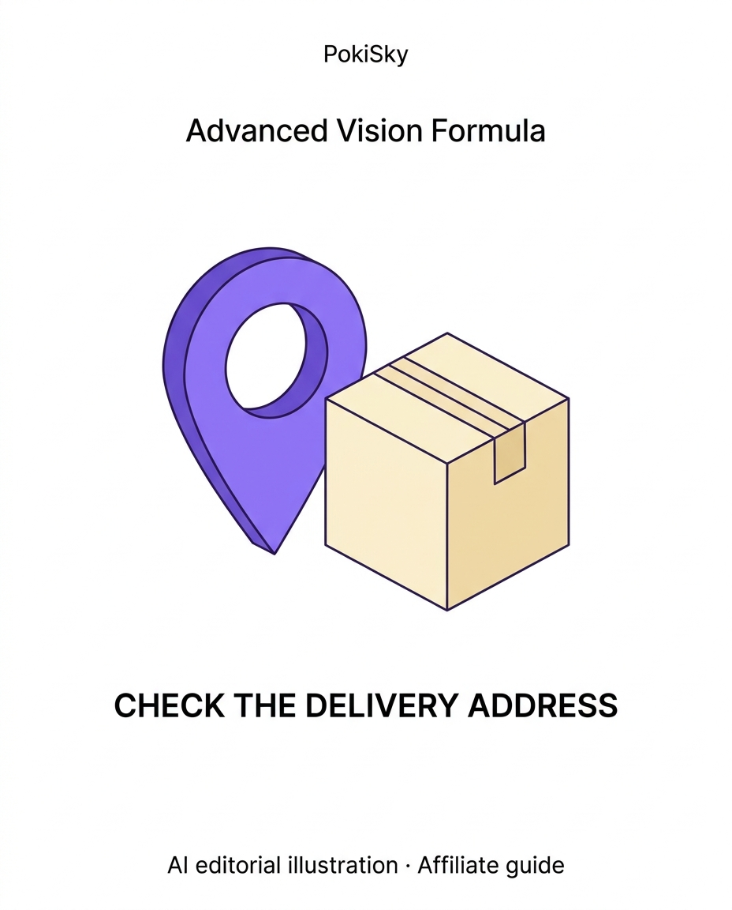
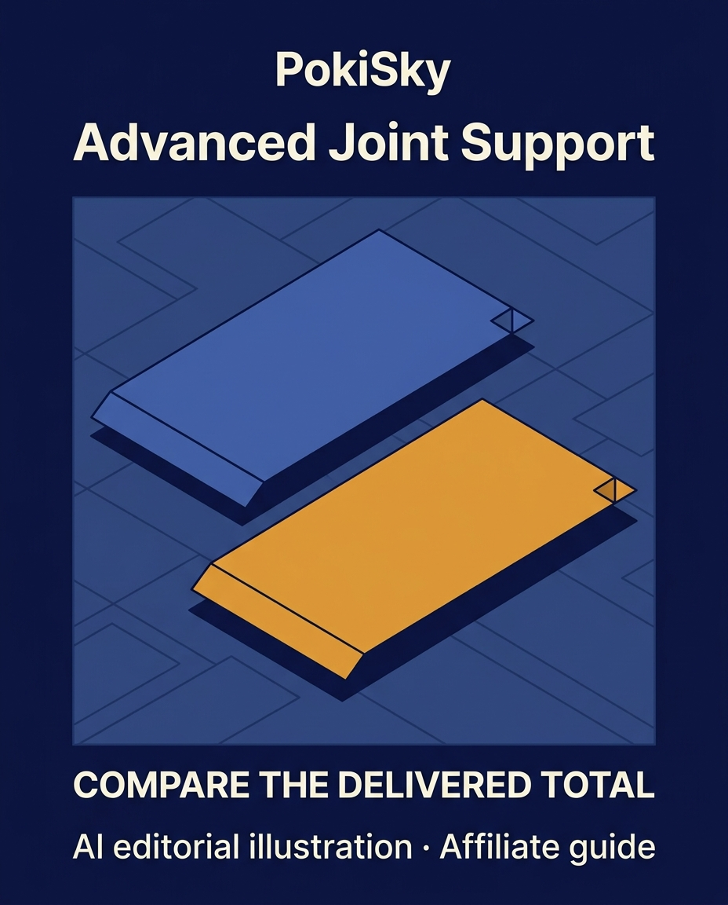
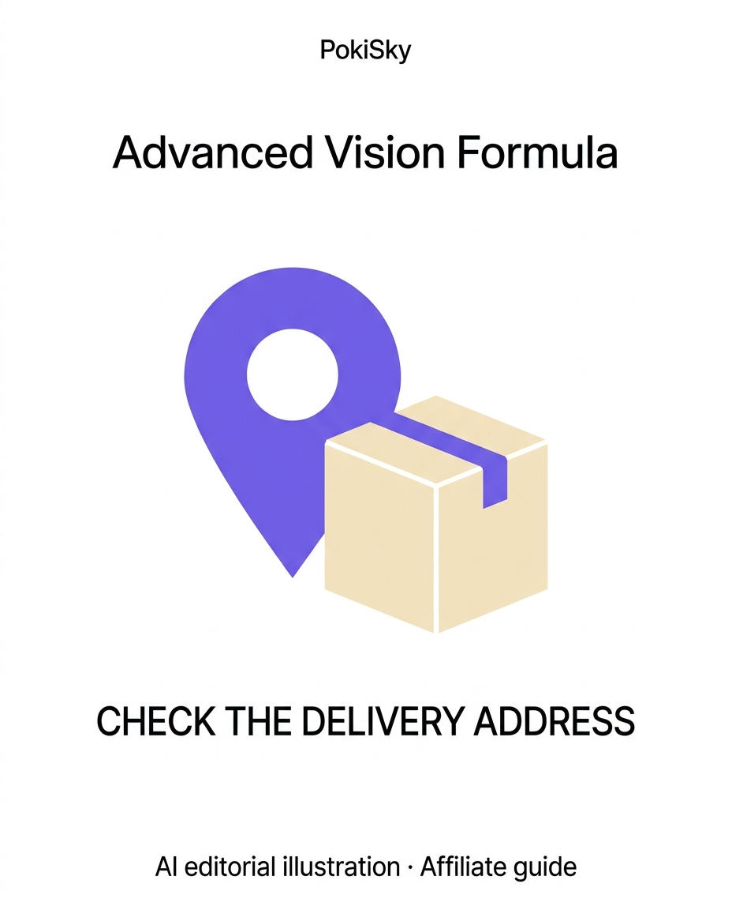
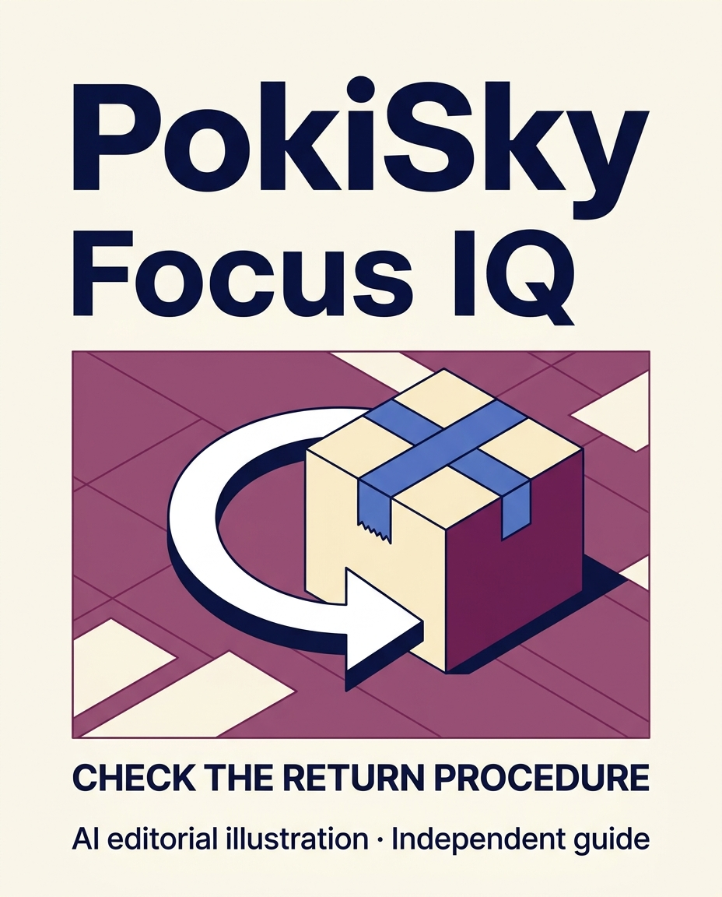
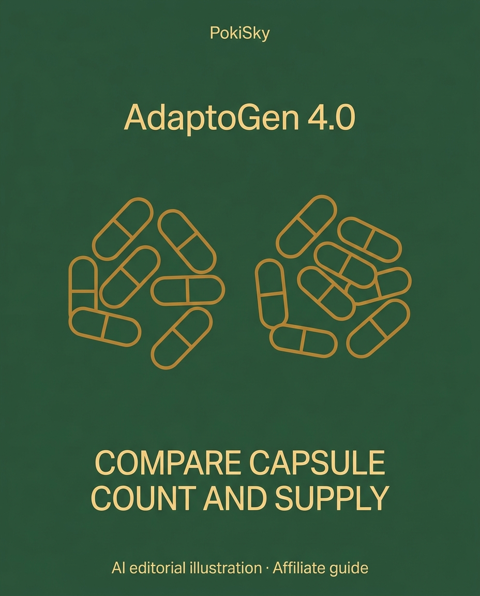

# Cinco posts PokiSky — 11 de novembro de 2026

Artes editoriais fornecidas pelo usuário após download do Gemini. Textos em inglês, com links para os guias do blog e sem alegações de teste ou resultado de saúde. A campanha está **preparada, não publicada**.

## 1. Advanced Vision Formula

**Arte:** CHECK THE DELIVERY ADDRESS · **Destaque:** Vision · **Fonte do guia:** 2026-10-07 · **Relação comercial:** link de afiliado

**Pinterest — Advanced Vision Formula: check delivery for your address**

Ad / affiliate disclosure: the PokiSky guide contains affiliate links. The guide records UK delivery information, but a country listing does not confirm delivery to every address. Check the exact destination, delivery charge, import requirements and final order total before choosing a pack. Read the guide. AI editorial illustration. Concept art.

**Facebook**

Ad / affiliate disclosure: the PokiSky guide contains affiliate links.

The supplier information reviewed for Advanced Vision Formula lists the UK among eligible destinations, but that does not confirm delivery to every address. Check the country selector, delivery charge, import requirements and final order total for your location. US free-shipping language is not a UK delivery quote.

Read the PokiSky guide:
https://blog-travel-eight.vercel.app/topics/wellness/vision-health/advanced-vision-formula?utm_source=facebook&utm_medium=organic_social&utm_campaign=supplement_rotation_20261111&utm_content=advanced-vision-formula

AI editorial illustration. Concept art.

**Instagram**

Ad / affiliate disclosure: the PokiSky guide contains affiliate links.

Before choosing a pack, check the destination you would actually use. The supplier information reviewed for Advanced Vision Formula lists the UK among eligible destinations, but delivery and the final total still need an address-specific check.

Find “Advanced Vision Formula” on the PokiSky blog. Copy this address into your browser:
https://blog-travel-eight.vercel.app/topics/wellness/vision-health/advanced-vision-formula?utm_source=instagram&utm_medium=organic_social&utm_campaign=supplement_rotation_20261111&utm_content=advanced-vision-formula

AI editorial illustration. Concept art.

#SupplementBuyingGuide #DeliveryCheck #PokiSky

**Texto alternativo:** PokiSky. Advanced Vision Formula. CHECK THE DELIVERY ADDRESS. A location pin beside a plain parcel. AI editorial illustration · Affiliate guide.

## 2. Advanced Joint Support

**Arte:** COMPARE THE DELIVERED TOTAL · **Destaque:** Joints · **Fonte do guia:** 2026-10-08 · **Relação comercial:** link de afiliado

**Pinterest — Advanced Joint Support: compare the full delivered cost**

Ad / affiliate disclosure: the PokiSky guide contains affiliate links. A dated UK check in the guide showed product and shipping separately for one three-bottle order; it is not a live quote or an address-specific total. Check eligibility, duties, taxes and payment conversion for your own order before comparing packs. Read the guide. AI editorial illustration. Concept art.

**Facebook**

Ad / affiliate disclosure: the PokiSky guide contains affiliate links.

The Advanced Joint Support guide records a dated, country-level UK check for a three-bottle order. It is not a live quote: the exact address, delivery eligibility, taxes, duties and payment conversion can change the total. Confirm the bottle version and the final order terms before comparing pack value.

Read the PokiSky guide:
https://blog-travel-eight.vercel.app/topics/wellness/joint-health/advanced-joint-support?utm_source=facebook&utm_medium=organic_social&utm_campaign=supplement_rotation_20261111&utm_content=advanced-joint-support

AI editorial illustration. Concept art.

**Instagram**

Ad / affiliate disclosure: the PokiSky guide contains affiliate links.

Compare the delivered total, not just the pack figure. The UK order check in the guide is dated and country-level; it does not confirm the amount for your address or include every possible tax, duty or conversion fee.

Find “Advanced Joint Support” on the PokiSky blog. Copy this address into your browser:
https://blog-travel-eight.vercel.app/topics/wellness/joint-health/advanced-joint-support?utm_source=instagram&utm_medium=organic_social&utm_campaign=supplement_rotation_20261111&utm_content=advanced-joint-support

AI editorial illustration. Concept art.

#BuyingChecklist #OrderTotal #PokiSky

**Texto alternativo:** PokiSky. Advanced Joint Support. COMPARE THE DELIVERED TOTAL. Two blank comparison cards with no prices or dates. AI editorial illustration · Affiliate guide.

## 3. DentiCore

**Arte:** SAVE THE DELIVERY DATE · **Destaque:** Nutrition · **Fonte do guia:** 2026-11-05 · **Relação comercial:** link de afiliado

**Pinterest — DentiCore: note when the return window starts**

Ad / affiliate disclosure: the PokiSky guide contains affiliate links. The written DentiCore refund policy reviewed for the guide says its 60-day period starts on delivery. Save the arrival date and check the current return steps, required order details and buyer-paid return postage before relying on the policy. Read the guide. AI editorial illustration. Concept art.

**Facebook**

Ad / affiliate disclosure: the PokiSky guide contains affiliate links.

The DentiCore refund policy reviewed in the guide says its 60-day period starts on delivery. Keep the delivery date and order details, then check the current instructions before mailing anything. The policy says the buyer pays return shipping; read the full terms and do not rely on a social post in place of them.

Read the PokiSky guide:
https://blog-travel-eight.vercel.app/topics/wellness/nutrition/denticore?utm_source=facebook&utm_medium=organic_social&utm_campaign=supplement_rotation_20261111&utm_content=denticore

AI editorial illustration. Concept art.

**Instagram**

Ad / affiliate disclosure: the PokiSky guide contains affiliate links.

Save the delivery date with your order details. The DentiCore policy reviewed in the guide says its 60-day return period starts when the order is delivered. Check the current procedure and return-postage terms before acting.

Find “DentiCore” on the PokiSky blog. Copy this address into your browser:
https://blog-travel-eight.vercel.app/topics/wellness/nutrition/denticore?utm_source=instagram&utm_medium=organic_social&utm_campaign=supplement_rotation_20261111&utm_content=denticore

AI editorial illustration. Concept art.

#ReturnChecklist #BuyingGuide #PokiSky

**Texto alternativo:** PokiSky. DentiCore. SAVE THE DELIVERY DATE. A calendar and a blank parcel card. AI editorial illustration · Affiliate guide.

## 4. Focus IQ

**Arte:** CHECK THE RETURN PROCEDURE · **Destaque:** Brain · **Fonte do guia:** 2026-10-31 · **Relação comercial:** link oficial sem rastreamento

**Pinterest — Focus IQ: check the return terms for your order**

Editorial disclosure: this guide uses untracked official links. The Primal Force store policy reviewed for the guide describes returns within 90 days, requires the bottles to be returned and estimates refunds at three to five business days after receipt. Ask how original shipping and return postage apply to the exact checkout. Read the guide. AI editorial illustration. Concept art.

**Facebook**

Editorial disclosure: this guide uses untracked official links.

The Primal Force store policy reviewed for the Focus IQ guide describes returns within 90 days and requires the bottles to be returned. It estimates a three-to-five-business-day refund process after receipt. The guide says to confirm how original shipping and return postage apply to the specific checkout; do not assume terms transfer between offers.

Read the PokiSky guide:
https://blog-travel-eight.vercel.app/topics/wellness/brain-health/focus-iq?utm_source=facebook&utm_medium=organic_social&utm_campaign=supplement_rotation_20261111&utm_content=focus-iq

AI editorial illustration. Concept art.

**Instagram**

Editorial disclosure: this guide uses untracked official links.

Before ordering, compare the return policy with the checkout you actually choose. The Primal Force store policy in the guide describes a 90-day period, bottle returns and an estimated refund interval; original shipping and return-postage details still need confirmation for that order.

Find “Focus IQ” on the PokiSky blog. Copy this address into your browser:
https://blog-travel-eight.vercel.app/topics/wellness/brain-health/focus-iq?utm_source=instagram&utm_medium=organic_social&utm_campaign=supplement_rotation_20261111&utm_content=focus-iq

AI editorial illustration. Concept art.

#PurchaseTerms #ReturnPolicy #PokiSky

**Texto alternativo:** PokiSky. Focus IQ. CHECK THE RETURN PROCEDURE. A simple return arrow loops around an abstract box. AI editorial illustration · Independent guide.

## 5. AdaptoGen 4.0

**Arte:** COMPARE CAPSULE COUNT AND SUPPLY · **Destaque:** Nutrition · **Fonte do guia:** 2026-10-26 · **Relação comercial:** link de afiliado

**Pinterest — AdaptoGen 4.0: compare capsule count with the label**

Ad / affiliate disclosure: the PokiSky guide contains affiliate links. The sales page calls a 60-capsule bottle a two-month supply, while the label reviewed in the guide gives serving directions that change the arithmetic. Compare the count with the exact label; this is label reading, not a personal dose recommendation. Read the guide. AI editorial illustration. Concept art.

**Facebook**

Ad / affiliate disclosure: the PokiSky guide contains affiliate links.

The AdaptoGen 4.0 sales page describes a 60-capsule bottle as a two-month supply. The label wording recorded in the guide changes that arithmetic depending on the stated serving frequency. Compare the bottle count with the exact label and ask a qualified professional about suitability. This is not a dosing recommendation.

Read the PokiSky guide:
https://blog-travel-eight.vercel.app/topics/wellness/nutrition/adaptogen-4?utm_source=facebook&utm_medium=organic_social&utm_campaign=supplement_rotation_20261111&utm_content=adaptogen-4

AI editorial illustration. Concept art.

**Instagram**

Ad / affiliate disclosure: the PokiSky guide contains affiliate links.

Does a bottle count match the seller’s “two-month supply” wording? The guide compares that claim with the label’s serving directions. It is a reading exercise, not a personal-use or dose recommendation.

Find “AdaptoGen 4.0” on the PokiSky blog. Copy this address into your browser:
https://blog-travel-eight.vercel.app/topics/wellness/nutrition/adaptogen-4?utm_source=instagram&utm_medium=organic_social&utm_campaign=supplement_rotation_20261111&utm_content=adaptogen-4

AI editorial illustration. Concept art.

#SupplementLabels #BuyingChecklist #PokiSky

**Texto alternativo:** PokiSky. AdaptoGen 4.0. COMPARE CAPSULE COUNT AND SUPPLY. Two groups of outlined capsules on a deep green background. AI editorial illustration · Affiliate guide.
